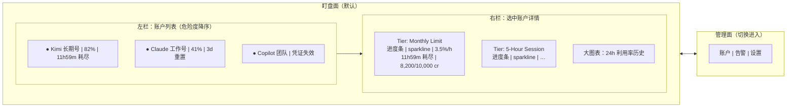
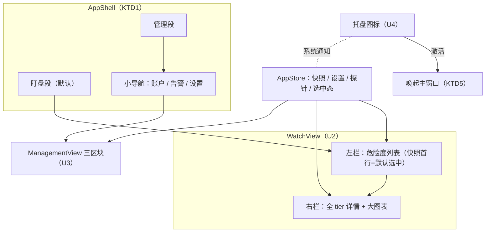

## Goal Capsule

- **Objective:** 用户打开应用后两秒内锁定最危账户，单户全部配额趋势与倒计时零点击可见；管理功能从盯盘流程中分离。
- **Means:** 两面信息架构——盯盘面为主从分栏，管理面内部三区块小导航；视觉走 Linear/Vercerl 式深色精致卡（用户选定）。
- **Product authority:** 应用所有者（本仓库单人项目）。本计划是 dashboard-first 重设计的唯一范围；后端行为、落地页、桌面小组件不在其中。
- **Stop conditions:** R1–R11 全部由实施单元承接，Verification Contract 全绿，过渡挂载与被替换模块无残留。
- **Execution profile:** `execution: code`；单分支渐进交付，每个单元落地后应用可运行；视觉单元以 preview 出图验收。
- **Owner:** 实施代理按 Implementation Units 完成并交付。
- **Open blockers:** 无。

---

## Product Contract

### Summary

把现有「概览/提供商/设置」三 tab 重构为单窗口双面结构：盯盘面（左：危险度排序账户列表；右：选中账户全 tier 详情含趋势图）+ 管理面（账户/告警/设置三区块）。删除托盘面板，托盘仅保留图标与系统通知。视觉全面升级为深色精致卡、高信息密度。

### Problem Frame

当前界面把监控任务和管理任务放在同一层（三 tab 平级），打开后要扫过整页卡片才能找到「现在最该担心谁」，首屏回答不了核心问题。tier 趋势图藏在点击后的弹窗里，卡片上只有进度条和倒计时，信息密度低；整体布局与视觉被判定为初级、丑陋，不符合所有者对「盯 Token 用量的 dashboard」的预期（参照 Linear/Vercerl 式精致卡）。托盘面板同样稀薄，与主窗口内容重叠。

### Key Decisions

- 双面结构：盯盘 + 管理，两面平级切换 (session-settled: user-directed — chosen over 三 tab 保留、单面板+抽屉：按盯盘节奏而非功能切分)。
- 盯盘面采用主从分栏 (session-settled: user-directed — chosen over 指标带+卡网格(B)、警报塔(A)：用户在三方案中直接选择)。Governs R1, R2, R3, R4。
- 管理面内部三区块小导航 (session-settled: user-directed — chosen over 单页滚动、抽屉式账户管理)。Governs R5, R6, R7, R8。
- 托盘面板删除，托盘只留图标 + 系统通知 (session-settled: user-directed — chosen over 升格第三面、迷你镜像：避免与盯盘面重复的 glance 面)。Governs R10, R11。
- 视觉参照 Linear/Vercerl 式精致卡：圆角、状态色描边、等宽数字、深色底 (session-settled: user-directed — chosen over Grafana 密集监控台、终端表格风)。Governs R9。
- 每 tier 数据密度：详情内「进度+趋势+速率」「倒计时+绝对值」布局，列表行紧凑摘要 (session-settled: user-approved — 用户跳过细选，委托 agent 在方案中给出，确认时默认接受)。Governs R2。
- 盯盘面列表移除手动排序 (session-settled: user-approved — agent 提议、随确认接受：排序只表达危险度)。Governs R3。

### Requirements

**盯盘面**

- R1. 应用打开即进入盯盘面：左栏为按危险度降序的账户列表行（状态点、显示名、最危 tier 名与利用率、耗尽或重置倒计时），右栏展示左栏选中账户的详情；默认选中危险度最高账户。
- R2. 右栏详情按 tier 分区，每个 tier 直接可见：利用率进度条、24 小时趋势 sparkline、燃烧速率（%/h）、耗尽/重置倒计时、绝对值额度（used/limit + 单位）。
- R3. 左栏排序仅由危险度决定（复用现有风险严重度 + 最早耗尽/重置次序规则），不提供手动排序控件。
- R4. 选中 tier 提供 24 小时利用率历史大图表，数据来自现有历史快照。

**管理面**

- R5. 管理面通过窗口级切换进入，内部小导航分三区块：账户、告警、设置。
- R6. 账户区块承载现有全部账户管理能力：账户列表、添加/编辑（含各 provider 配置字段、密钥输入、Copilot 设备码流程）、CLI 凭证扫描与重新扫描、环境变量发现、一键导入、删除确认。
- R7. 告警区块按账户与 tier 编辑阈值规则：每条规则含启用开关与 1–99 整数阈值；无限额 tier 的规则不可启用。
- R8. 设置区块承载刷新间隔（5/10/15/30 分钟）、界面语言（zh-CN/en）、清除历史（带确认）。

**全局与视觉**

- R9. 全应用使用深色主题与统一卡片语言：圆角卡、语义状态色描边与徽章、等宽数字；颜色全部取自主题 token，不出现硬编码色值。
- R10. 托盘仅保留图标与系统通知；托盘面板窗口及其锚定、几何代码删除。
- R11. 系统通知行为保持不变：达到阈值与耗尽各通知一次，周期重置后可再次通知。

盯盘面布局线框：

### Key Flows

- F1. 打开即盯盘
  - **Trigger:** 应用启动或从管理面切回。
  - **Steps:** 盯盘面显示；左栏按危险度排序并默认选中首行；右栏渲染其全部 tier。
  - **Covers R1, R3.**
- F2. 选中另一账户
  - **Trigger:** 左栏行被点击。
  - **Steps:** 右栏切换为该账户详情；各 tier 的进度、趋势、速率、倒计时、绝对值直接呈现，无二级点击。
  - **Covers R2, R4.**
- F3. 管理操作
  - **Trigger:** 用户切换到管理面。
  - **Steps:** 小导航定位区块；账户增删改/扫描导入、告警阈值编辑、设置变更各在其区块完成；返回盯盘面后数据反映变更。
  - **Covers R5, R6, R7, R8.**
- F4. 告警触达
  - **Trigger:** 刷新周期内某 tier 达到阈值或被判定耗尽。
  - **Steps:** 系统通知发出一次；无托盘面板参与；下周期重置前不重复。
  - **Covers R10, R11.**

### Acceptance Examples

- AE1. **Covers R1, R3.** Given 多账户且存在 at_risk 账户，When 应用打开，Then 盯盘面直接可见，左栏首行即该账户且已选中，右栏显示其详情。
- AE2. **Covers R2.** Given 选中账户含两个 tier，Then 每个 tier 的进度条、sparkline、燃烧速率、倒计时、绝对值五项全部直接可见，无需点击。
- AE3. **Covers R7.** Given 某 tier 为无限额，When 打开其告警规则，Then 启用开关为禁用态。
- AE4. **Covers R10, R11.** Given 托盘图标存在，When 点击托盘，Then 不出现托盘面板；Given 某 tier 达到阈值，Then 收到一次系统通知。
- AE5. **Covers R8.** When 在设置区块点击清除历史，Then 出现确认对话框；确认后历史清空且下轮刷新后预测重算。
- AE6. **Covers R8.** When 语言在 zh-CN 与 en 间切换，Then 立即生效于当前面全部文案并持久化。

### Success Criteria

- SC1. 冷启动后两秒内能指出最危账户及其最危 tier 的状态（对应 Problem Frame 的首屏失焦，验证方式为所有者本人使用验收）。
- SC2. 单个账户的全部 tier 趋势与倒计时在选中后零点击可见。
- SC3. 规划可直接基于本契约执行，无需发明任何用户行为、范围或验收标准。

### Scope Boundaries

- 后端数据模型、刷新调度、预测与告警判定逻辑不变（纯 UI/IA 层重做）。
- 账户添加/编辑的字段、校验、密钥处理与 Copilot 设备码流程行为不变，仅迁入管理面账户区块。
- 托盘面板及其锚定/几何逻辑删除；不做替代 glance 面（per R10）。
- 盯盘面的手动账户排序（现有 ↑/↓ 与恢复排序）移除（per R3）。
- 桌面小组件、落地页（website/）不在范围。
- 各 provider 的配额解析与新增 provider 不在范围。

### Dependencies / Assumptions

- 现有每 tier 历史快照数据（最近采样序列）足以绘制 24h sparkline 与大图表。
- gpui-kit 当前组件（分栏、滚动区、图表、表单控件）能够承载本设计；本次会话已验证相关 API 存在。
- 每 tier 密度与左栏行高按 Key Decisions 的密度决定执行，具体像素与字号由规划按主题尺度定。

### Sources / Research

- 现有 UI 实现：src/ui/（shell、overview、providers_tab、settings_tab、tray、tray_panel、tier_view、store）。
- 数据与服务层：src/service.rs（刷新、快照、历史、设置）、src/domain.rs（风险严重度与排序规则）。
- 本地化文案基线：assets/i18n/en.json、assets/i18n/zh-CN.json。
- 视觉验证工具链：cargo run --features preview --bin preview（真实窗口出图至 /tmp/lt-ui-*.png）、tests/ui_visual.rs（渲染冒烟）。

---

## Planning Contract

Product Contract preservation: restructured, no scope change — Outstanding Questions 的三条 Deferred 已由 KTD1/KTD2/KTD3 就地解答并删除；R-IDs、Key Decisions、F/AE 编号与含义均未改动。

### Key Technical Decisions

- KTD1. 两面切换落在窗口顶部的两段式分段控件 (session-settled: user-approved — chosen over 内容区内切换、保留三 tab 骨架改名：5.1.5 确认时选定)。管理面的三区块小导航嵌套在第二段之内；应用启动始终落在盯盘段。Governs R1, R5.
- KTD2. 原「最早风险预警」英雄卡随主从分栏移除 (session-settled: user-approved — chosen over 保留英雄卡于左栏之上：左栏首行即最危账户，双保险反而稀释首屏)。Governs R1.
- KTD3. 手动账户排序整体删除，管理面也不保留重排入口 (session-settled: user-approved — chosen over 管理面保留排序：brainstorm 将此项 Deferred 给规划，5.1.5 确认时定为删除)。排序模型唯一：危险度。Governs R3.
- KTD4. sparkline 与大图表复用 gpui-kit 图表组件 (session-settled: user-approved — chosen over 自绘 canvas：本会话已验证图表 API 与主题 token 体系兼容)。Governs R2, R4.
- KTD5. 托盘激活改为唤起并聚焦主窗口 (agent 规划默认，无 session 标签 — R10 删除面板后图标失去响应；留空会成为死图标，唤起主窗口是面板切换的最小替代)。Governs R10.

### High-Level Technical Design

数据全部来自既有 AppStore 快照与历史接口，本计划不新增数据通道；选中态是 AppStore 内的账户 id，详情数据按选中 id 从快照与 `get_tier_history` 派生。

### Assumptions

- 左栏行高、分栏默认宽度与密度档位由实施按主题尺度（rem 助手与组件尺寸档）确定，不出现裸像素产品尺寸。
- 双面与管理小导航的新增文案键在两份 locale（assets/i18n/en.json、assets/i18n/zh-CN.json）同步补齐，结构键数保持一致。
- 过渡期（U1 单元落地时）两面容器暂挂现有页面渲染，U2/U3 完成后清空过渡挂载——这是单元内明示的临时结构，非最终行为。

### Sequencing

单元顺序 U1 → U2 → U3 → U4 → U5；U4 仅依赖 U1，可与 U2/U3 对调。每个单元落地后 `cargo check --all-targets` 与 `cargo test` 必须全绿，应用保持可运行。

---

## Implementation Units

### U1. 双面应用壳

- **Goal:** 应用壳从「概览/提供商/设置」三 tab 改为「盯盘/管理」两段式切换，两个容器先挂现有内容保证可运行。
- **Requirements:** R1（启动落在盯盘段）、R5（管理经窗口级切换进入）；落实 KTD1。
- **Dependencies:** 无。
- **Files:** src/ui/shell.rs、assets/i18n/en.json、assets/i18n/zh-CN.json、tests/ui_visual.rs。
- **Approach:**
  1. 在 shell 状态中以 `Surface` 枚举（Watch/Management）替换原三页 `TabPage`，顶部分段控件仅两段。
  2. Watch 容器暂挂现有 overview 渲染，Management 容器纵排现有 providers 与 settings 渲染——纯过渡挂载，接口不变。
  3. 新增切换文案键（两段标签）与管理小导航三区块键，两 locale 同步。
  4. 应用入口默认 `Surface::Watch`。
- **Patterns to follow:** src/ui/shell.rs 现有 TabBar segmented + `cx.listener` 模式；i18n 走 `store.t`/`store.tp`。
- **Test scenarios:**
  - 无头打开窗口后断言默认渲染盯盘段容器，管理段容器不可见。
  - 点击「管理」段 → 管理容器可见、盯盘容器隐藏；点击「盯盘」可切回。
  - 语言切到 en 后两段标签为英文文案，切回 zh-CN 恢复。
  - tests/ui_visual.rs 的页面冒烟改为两面各一张，全部 `render_frame` 通过。
- **Verification:** `cargo test` 全绿；`cargo run --features preview --bin preview` 出图可见两段切换控件。

### U2. 盯盘面主从分栏

- **Goal:** 盯盘段替换为左栏危险度列表 + 右栏选中账户全 tier 详情；移除英雄卡、手动排序与点击式弹窗详情。
- **Requirements:** R1、R2、R3、R4；AE1、AE2；F1、F2；落实 KTD2、KTD3、KTD4。
- **Dependencies:** U1。
- **Files:** src/ui/watch.rs（新建）、src/ui/overview.rs（迁移后删除）、src/ui/tier_view.rs、src/ui/store.rs、src/ui/shell.rs、tests/ui_visual.rs、src/preview.rs。
- **Approach:**
  1. 左栏行直接消费后端已按危险度排序的快照顺序（复用 `worst_tier`/`risk_severity` 既有语义），行内为状态点、显示名、最危 tier 摘要与倒计时。
  2. AppStore 增加选中账户 id 状态，默认值为快照首行；点击行更新该状态并通知重绘（落实 KTD6 选中机制，此处为单元级机制说明）。
  3. 右栏按 tier 分区：复用 tier 行布局，每行含进度条、sparkline、燃烧速率、倒计时、绝对值五要素；选中 tier 的 24h 大图表复用现有历史加载路径。
  4. 删除 `move_account`、恢复排序按钮、英雄卡与 TierDetail 弹窗——详情常驻右栏，弹窗层不再承载。
- **Patterns to follow:** src/ui/tier_view.rs 的状态色与格式化 helpers；src/ui/store.rs 的 `load_history`。
- **Test scenarios:**
  - 存在 at_risk 账户时，首行即该账户且处于选中态（AE1）。
  - 点击第二行后右栏标题变为该账户名，tier 数量与快照一致。
  - 选中含两个 tier 的账户，断言每个 tier 五要素控件均存在且可见（AE2）。
  - 无限额 tier 显示无限标识、速率不显示。
  - 无账户时空态出现；凭证失效账户的行与右栏显示错误文案。
  - 英雄卡区域与 ↑/↓ 排序按钮在断言中不存在。
  - sparkline 在有历史数据时渲染出非零宽度；无历史时显示占位空态。
- **Verification:** `cargo test` 全绿；preview 出图人工对照 R1–R4 与线框；`grep -n "move_account\|reset-order" src/` 无命中。

### U3. 管理面三区块

- **Goal:** 管理段落地为账户/告警/设置三区块小导航，承载现有全部管理能力，告警规则升格为独立区块。
- **Requirements:** R5、R6、R7、R8；AE3、AE5、AE6；F3。
- **Dependencies:** U1；与 U2 无代码交叠，可并行。
- **Files:** src/ui/management.rs（新建）、src/ui/providers_tab.rs（能力迁入后删除）、src/ui/settings_tab.rs（能力迁入后删除）、src/ui/shell.rs、assets/i18n/en.json、assets/i18n/zh-CN.json、tests/ui_visual.rs、src/preview.rs。
- **Approach:**
  1. 管理段内用子级分段导航切三区块，账户区块为默认。
  2. 账户区块整体复用现有账户列表、添加/编辑表单、CLI 扫描与一键导入的渲染与交互逻辑（行为不变，仅容器迁移）。
  3. 告警区块按账户分组列出其规则：开关 + 1–99 阈值输入，无限额 tier 禁用开关；数据取自 store 的账户规则与快照 tier 元信息。
  4. 设置区块复用现有刷新间隔、语言、清历史渲染逻辑。
- **Patterns to follow:** src/ui/providers_tab.rs 的 AccountForm 与对话框模式；src/ui/settings_tab.rs 的 RadioGroup 单选模式。
- **Test scenarios:**
  - 三区块各自渲染且互斥切换，账户区块为默认。
  - 无限额 tier 的告警开关为禁用态（AE3）。
  - 删除账户弹出确认对话框，取消不删、确认后账户从列表消失。
  - 清除历史弹出确认对话框，确认后触发清空（AE5）。
  - 语言切换后管理面全部区块文案即时变化并持久化（AE6）。
  - CLI 重新扫描按钮触发探针刷新；一键导入触发导入流程并给出结果通知。
  - Copilot 设备码三种状态（请求中/轮询中/失败）各自渲染。
- **Verification:** `cargo test` 全绿；preview 出管理面图对照三区块结构。

### U4. 托盘纯图标化

- **Goal:** 删除托盘面板窗口与其几何/锚定逻辑，托盘仅保留图标与系统通知，激活唤起主窗口。
- **Requirements:** R10、R11；AE4；落实 KTD5。
- **Dependencies:** U1；与 U2/U3 可对调。
- **Files:** src/ui/tray.rs、src/ui/tray_panel.rs（删除）、src/ui/mod.rs、src/main.rs、tests/backend_tests.rs（删除托盘几何与钳制测试）、tests/ui_visual.rs。
- **Approach:**
  1. 保留图标创建与 Action 分发；`TogglePanel` 语义改为 `OpenMain`——激活时聚焦已注册主窗口，未注册则忽略。
  2. 删除面板开窗、`PANEL_WINDOW`、`close_panel`、`compute_panel_position`/`clamp_panel_height`/`TRAY_PANEL_*` 常量及 StoreGlobal 中面板专用入口（若 AppStore 全局仍被主窗口使用则保留其注册）。
  3. 同步删除依赖被删函数的集成测试块。
- **Patterns to follow:** src/ui/tray.rs 现有 Action 分发与 Global 持有模式。
- **Test scenarios:**
  - 自动化：`cargo test` 全绿，且 tests/backend_tests.rs 不再引用被删几何函数。
  - 结构断言：src 中不存在面板开窗调用（`grep -n "tray_panel" src/` 无命中）。
  - 手动冒烟：运行后托盘图标存在；点击图标主窗口被唤起且无面板出现；告警路径仍发系统通知（AE4）。
- **Verification:** `cargo test` 全绿；手动冒烟按上述三项执行并记录结果。

### U5. 视觉打磨与验证收尾

- **Goal:** 按 R9 统一两面视觉（卡片语言、状态色、等宽数字、间距尺度），清理过渡代码与裸键，完成全量视觉验收。
- **Requirements:** R9；SC1、SC2 的可视化支撑。
- **Dependencies:** U2、U3、U4。
- **Files:** src/ui/*、src/preview.rs、tests/ui_visual.rs、assets/i18n/en.json、assets/i18n/zh-CN.json。
- **Approach:**
  1. 逐面跑 preview 出图，对照 R9 逐项修：小写 provider 标签统一为大写或徽章形式、数字列用等宽样式、状态描边/徽章按语义色 token 收敛。
  2. 全局清扫：U1 过渡挂载移除、被删模块引用归零、`grep -rn "#[0-9a-fA-F]\{6\}\|rgb(" src/ui` 无硬编码色值、i18n 无裸键渲染。
  3. 更新 preview fixture 输出两面四图（盯盘/管理/托盘点击前态）供最终验收。
- **Patterns to follow:** src/ui/tier_view.rs 既有 `status_color`/`utilization_color` 语义取色。
- **Test scenarios:**
  - 两 locale 顶层键集合一致断言（防止新增键只落单语种）。
  - 硬编码色值扫描为零的断言可由 grep 结果人工核。
  - 样式微调本身：Test expectation: none —— 纯视觉，验收走 preview 出图与 SC1/SC2 人工核对。
- **Verification:** `cargo check --all-targets`、`cargo test`、preview 出图三绿；按 Definition of Done 全局项逐条核对。

---

## Verification Contract

| 验证项 | 命令/方式 | 适用单元 | 通过标准 |
|---|---|---|---|
| 编译与告警 | `cargo check --all-targets` | U1–U5 | 0 error、0 unused 告警 |
| 单元与集成测试 | `cargo test` | U1–U5 | 全绿（backend_tests + ui_visual 套件） |
| 视觉验收 | `cargo run --features preview --bin preview` | U1、U2、U3、U5 | /tmp/lt-ui-*.png 产出且对照契约无偏 |
| 手动冒烟 | `cargo run` 后走查 | U4、U5 | 托盘激活唤起主窗口、无面板；通知路径不回归 |
| 残留扫描 | `grep -rn "tray_panel\|move_account\|reset-order" src/` | U4、U5 | 无命中 |

仓库无 `release:validate` 发布门脚本，本计划不适用发布验证项。

---

## Definition of Done

**全局**

- R1–R11 每条可指认到唯一实施单元，对应 test scenarios 落地并通过。
- Verification Contract 五项全部通过。
- 被替换模块（src/ui/overview.rs、src/ui/providers_tab.rs、src/ui/settings_tab.rs、src/ui/tray_panel.rs）与托盘几何测试已删除且无残留引用。
- `src/ui` 下无硬编码颜色值；i18n 渲染路径无裸键（preview 图人工核对）。
- 过渡挂载（U1 引入的临时容器）已随 U2/U3 完成而清除——中止尝试与死代码不留存于 diff。

**按单元**

- U1–U5 各自的 Test scenarios 全数存在且通过；U5 完成后按全局项复核一遍。
